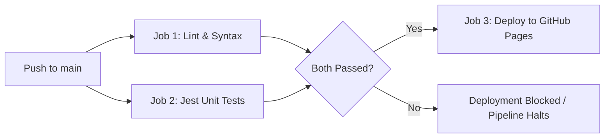

# WERKSTATT // Bauhaus GitHub Portfolio

A responsive, high-performance web portfolio built with pure vanilla web standards, inspired by the historical Bauhaus aesthetic (Dessau & Weimar). It features interactive geometric animations, live GitHub repository querying, an in-browser developer terminal, and a strict dual-gate CI/CD deployment pipeline.

---

## Key Features

- **Bauhaus Design System**: Bold primary palette (Vermilion Red, Cobalt Blue, Sun Yellow, Pitch Black, and Warm White) paired with crisp structural grid lines and architectural typography (`Syne`, `Space Grotesk`, `JetBrains Mono`).
- **Interactive Landing Elements**:
  - Kinetic HTML5 Canvas with dynamic node-network physics reacting to cursor movements.
  - Interactive Geometric Sculpture with customizable random configuration shuffle.
  - Real-time CAD coordinate tracking HUD.
- **Dynamic Projects Showcase**:
  - Instant tag and category filtering (`Web Apps`, `Dev Tools`, `Systems & CLI`, `Creative Code`).
  - Client-side full-text search across repository names, languages, and descriptions.
  - Live GitHub API integration to dynamically query and display any public GitHub user's repositories.
  - Detailed project modals with one-click `git clone` command copying.
- **In-Browser Developer Terminal**: Interactive shell supporting navigation and informational commands (`help`, `repos`, `clone <repo>`, `philosophy`, `skills`, `contact`, `clear`).
- **Zero Runtime Dependencies**: 100% vanilla HTML5, CSS3, and modern JavaScript with browser-native Web Audio API synthesis for mechanical click feedback.

---

## Project Structure

```text
projects-portfolio/
├── .github/
│   └── workflows/
│       └── deploy.yml          # GitHub Actions CI/CD (Lint + Jest Tests -> GitHub Pages Deploy)
├── __tests__/
│   └── utils.test.js          # Jest unit test suite (41 tests covering core logic)
├── .gitignore                  # Git ignore rules for node_modules and logs
├── .nojekyll                  # Disables Jekyll processing for direct static asset serving
├── eslint.config.mjs           # ESLint 9+ flat configuration with browser and Jest environments
├── favicon.svg                 # Bauhaus geometric SVG favicon
├── index.html                  # Semantic HTML5 structure and layout
├── package.json                # Project scripts (lint, test) and dev dependencies
├── package-lock.json           # Locked dependency tree
├── README.md                   # Project documentation and developer guide
├── script.js                   # Application state, Canvas engine, UI event bindings, API fetch
├── style.css                   # Responsive Bauhaus layout styles, grid, animations, and modals
└── utils.js                    # Pure utility functions (XSS escaping, filtering, categories, commands)
```

---

## Testing & Quality Control

Unit tests are written with [Jest](https://jestjs.io/) and test pure functional units exported from `utils.js` (including sanitization, filtering algorithms, category inference, and string manipulation):

| Suite | Focus Areas | Test Count |
| :--- | :--- | :--- |
| `escapeHtml()` | XSS mitigation, escaping `&`, `<`, `>`, `"`, `'`, type coercion | 10 tests |
| `inferCategoryFromLanguage()` | Mapping GitHub languages to portfolio categories (`web`, `systems`, etc.) | 14 tests |
| `filterRepos()` | Category matching, case-insensitive keyword searches, combined filters | 10 tests |
| `countByCategory()` | Aggregation metrics calculations and defensive defaults | 3 tests |
| `buildCloneCommand()` | Formatting `git clone` commands and empty-input protection | 4 tests |

### Running Checks Locally

```bash
# Run unit tests with Jest
npm test

# Run ESLint validation
npm run lint

# Run Node syntax checks
npm run lint:syntax
```

---

## GitHub Actions Deployment Pipeline

The automated deployment pipeline (`.github/workflows/deploy.yml`) implements a strict **Dual-Quality Gate** before publishing:



1. **Gate 1 (`lint`)**: Executes `node --check` syntax checks and ESLint verification across all source files.
2. **Gate 2 (`test`)**: Runs all 41 Jest unit tests (`npm test`).
3. **Deployment (`deploy`)**: Defined with `needs: [lint, test]`. GitHub Pages deployment triggers **only if both quality gates pass**. Any linting error or test failure halts the pipeline immediately.

---

## Quick Start (Local Development)

### Prerequisites
- Node.js (v20+ recommended)
- npm

### Setup & Run

1. **Clone the repository**:
   ```bash
   git clone https://github.com/cknwyn/projects-portfolio.git
   cd projects-portfolio
   ```

2. **Install development dependencies**:
   ```bash
   npm install
   ```

3. **Run the quality checks**:
   ```bash
   npm run lint
   npm test
   ```

4. **Serve the portfolio locally**:
   ```bash
   # Using npx serve
   npx serve .

   # Or using Python 3
   python -m http.server 8000
   ```
   Open `http://localhost:3000` (or `http://localhost:8000`) in your web browser.
